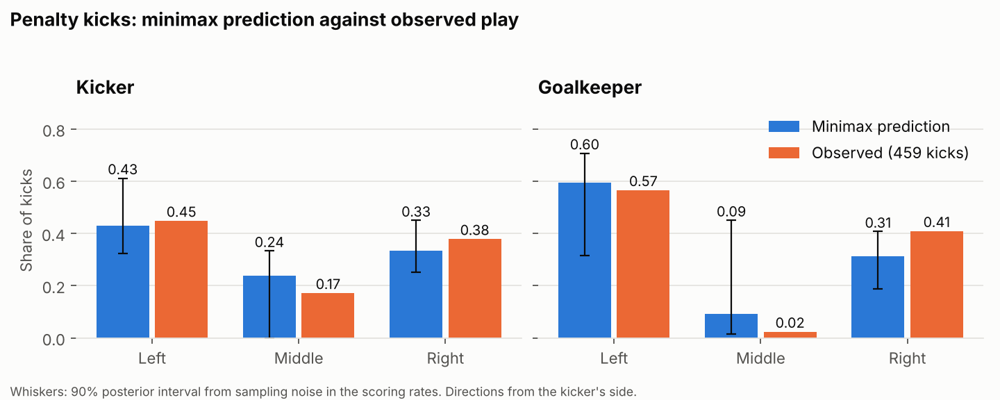
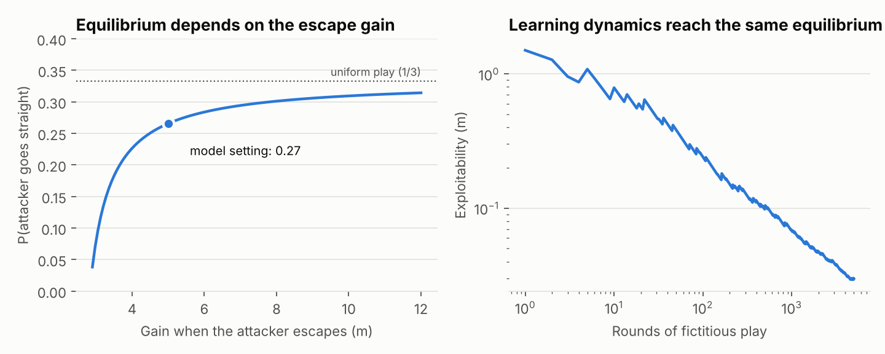

# Is there an optimal strategy in football?

**Two football duels modelled as zero-sum games, solved exactly, and confronted with
459 real penalty kicks.**

A penalty kick and a one-on-one between an attacker and a defender share the same
structure: two players with opposite interests who must commit at the same time. This
repository solves both as matrix games and asks how far the minimax prediction matches
what professionals actually do.



## Results

### Penalty kicks

Payoffs are the scoring rates from Chiappori, Levitt and Groseclose (2002): every
penalty in the French and Italian first leagues over three seasons, by kicker and
goalkeeper direction.

| | Left | Middle | Right |
|---|---|---|---|
| Kicker, minimax prediction | 0.43 | 0.24 | 0.33 |
| Kicker, observed | 0.45 | 0.17 | 0.38 |
| Goalkeeper, minimax prediction | 0.60 | 0.09 | 0.31 |
| Goalkeeper, observed | 0.57 | 0.02 | 0.41 |

- The model predicts a scoring rate of 76.3%; the observed rate is 74.9%.
- The ordering of all six frequencies is correct, including the asymmetry between the
  kicker's natural side and the other one.
- A chi-square test still rejects the pooled prediction (p = 0.003 for kickers,
  p < 10⁻⁸ for goalkeepers). Both players use the middle less than the model says they
  should.
- The payoff matrix is itself an estimate: three of its nine cells rest on 3 or 4
  kicks. Drawing each cell from its Beta posterior and re-solving the game gives the
  90% intervals in the figure. They are wide, and five of the six observed frequencies
  fall inside them (the goalkeeper's right-side share sits just outside), so the
  rejection above says as much about pooling heterogeneous players as about minimax
  play. That is the central point of the original paper.
- Dropping the middle option, as textbook treatments often do, gives a worse fit:
  the 2×2 game predicts 60% of kicks to the left against 45% observed.

### One-on-one marking

An attacker runs at a defender 4 m away. Each goes straight or cuts 45° to one side;
if they arrive on the same spot the defender wins the ball. The attacker's payoff is
the distance covered in possession. The payoff matrix is derived from the geometry in
`footgt.marking`, not typed in.

- Equilibrium for both players: straight 27%, left 37%, right 37%. Value 4.20 m.
- 100 000 simulated duels give a mean gain of 4.206 ± 0.007 m.
- The share of straight runs is driven by one modelling choice, the gain credited to
  an attacker who escapes. The left panel below shows the dependence.
- Fictitious play, where each player best-responds to the other's past choices,
  converges to the same strategies, which checks the linear-programming solver by an
  independent route.



## Reproduce

```bash
git clone https://github.com/jenayaalidesme-dot/football-game-theory.git
cd football-game-theory
pip install -e ".[dev]"
pytest                           # 42 tests
python scripts/make_figures.py   # rewrites figures/ and prints every number above
```

Random draws use a fixed seed (`--seed`, default 2026), so the figures and printed
numbers are identical from one run to the next. Continuous integration runs the
linter, the tests and the figure script on Python 3.10 and 3.12.

## Layout

```
src/footgt/
  zerosum.py    LP solver for zero-sum games, exploitability, fictitious play
  penalty.py    data loading, posterior draws of the equilibrium, goodness of fit
  marking.py    geometric payoff matrix and Monte Carlo duels
data/           penalty-kick counts, with provenance
scripts/        make_figures.py
tests/          known games, properties on random games, checks against the paper
```

## How the solver is tested

- Games with a known answer: matching pennies, rock-paper-scissors, a saddle point,
  and the closed form for 2×2 games.
- Twenty random games of varying shape: the returned strategies must leave neither
  player any profitable deviation (zero exploitability).
- The data file must reproduce the totals and the percentages printed in the paper.

## Limits

- Players are pooled. Individual kickers and goalkeepers have their own payoff
  matrices; the data here cannot separate them.
- Three directions is a coarse description of a kick. Height and power are ignored.
- The marking model has one step and no speed difference. A sequential version (a
  game tree in which the defender reacts) is the natural next step.

## Background

This started as my TIPE, the year-long research project of the French *classes
préparatoires*, titled "Existe-t-il une stratégie optimale au football ?". The
original work was a slide deck and standalone scripts. This repository is a later
rewrite as a tested package, with the three-direction penalty game, the uncertainty
analysis and the fictitious-play check added.

## References

- P.-A. Chiappori, S. Levitt, T. Groseclose (2002). Testing Mixed-Strategy Equilibria
  When Players Are Heterogeneous: The Case of Penalty Kicks in Soccer. *American
  Economic Review* 92(4), 1138–1151.
- I. Palacios-Huerta (2003). Professionals Play Minimax. *Review of Economic Studies*
  70(2), 395–415.
- J. Robinson (1951). An Iterative Method of Solving a Game. *Annals of Mathematics*
  54(2), 296–301.

## Licence

MIT. Jenaya Ali Desme.
